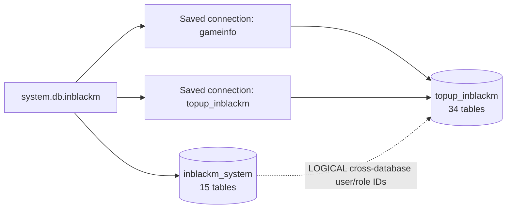
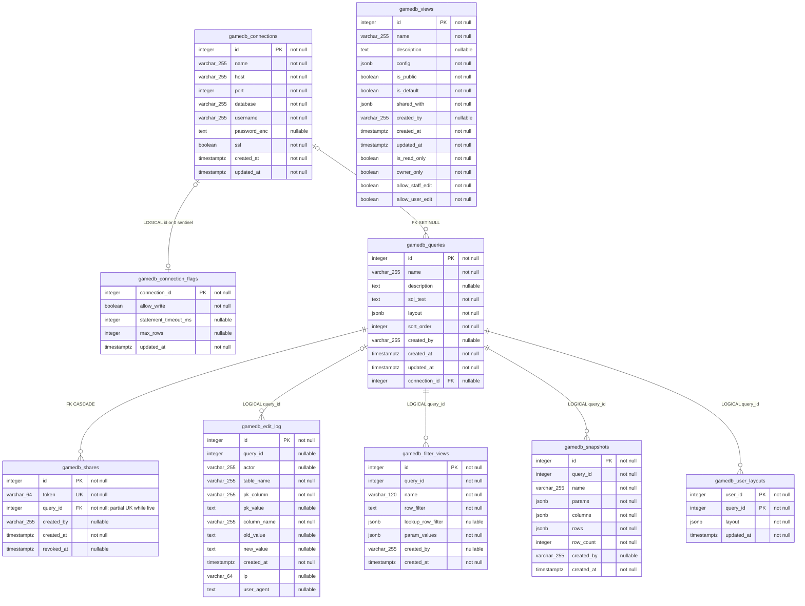
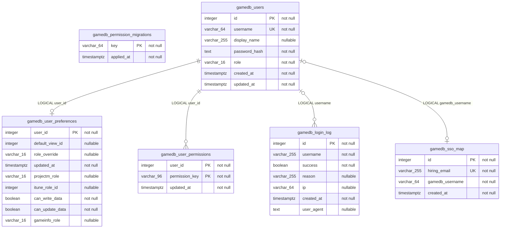
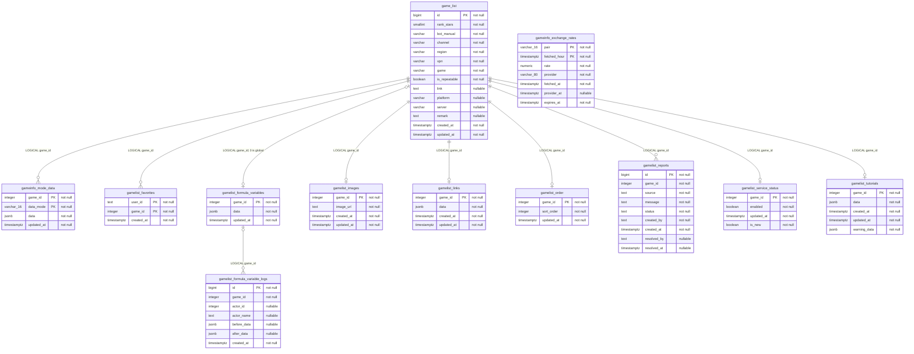
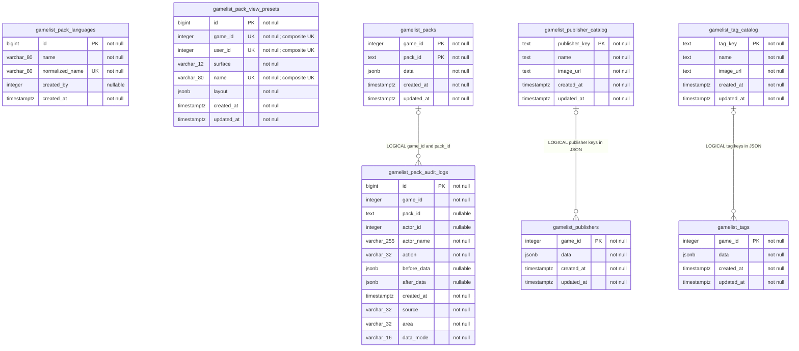
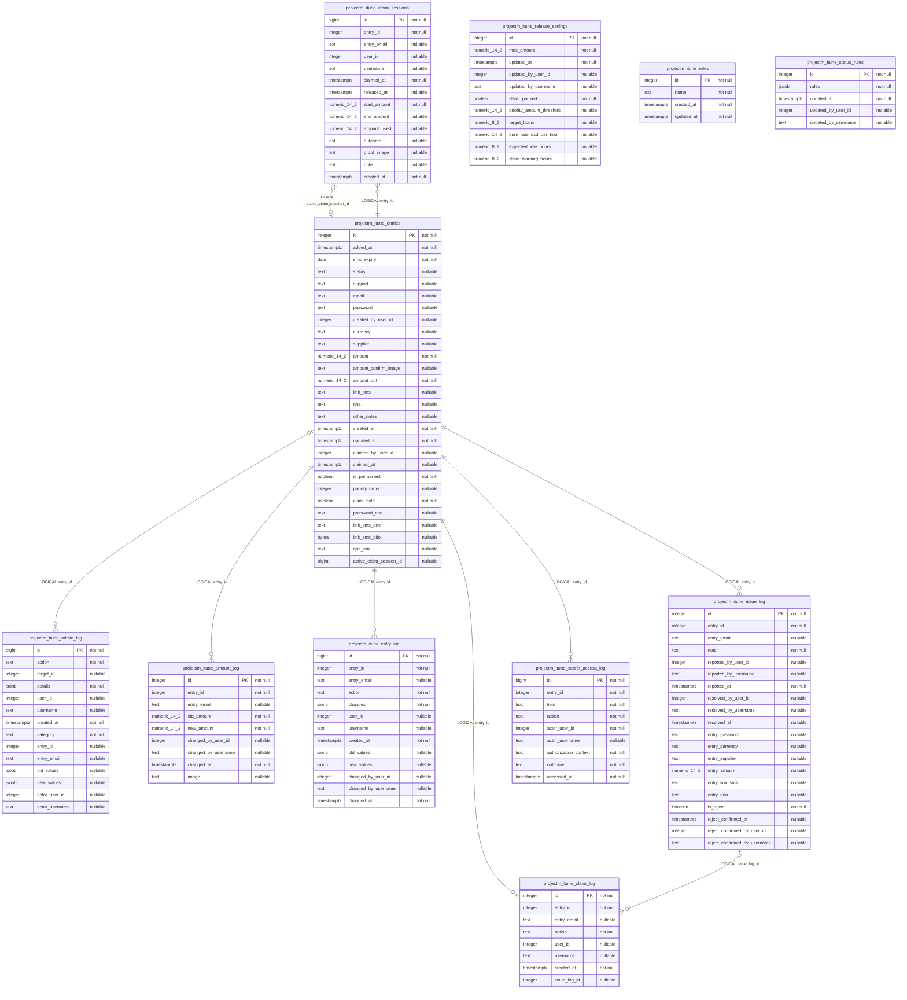
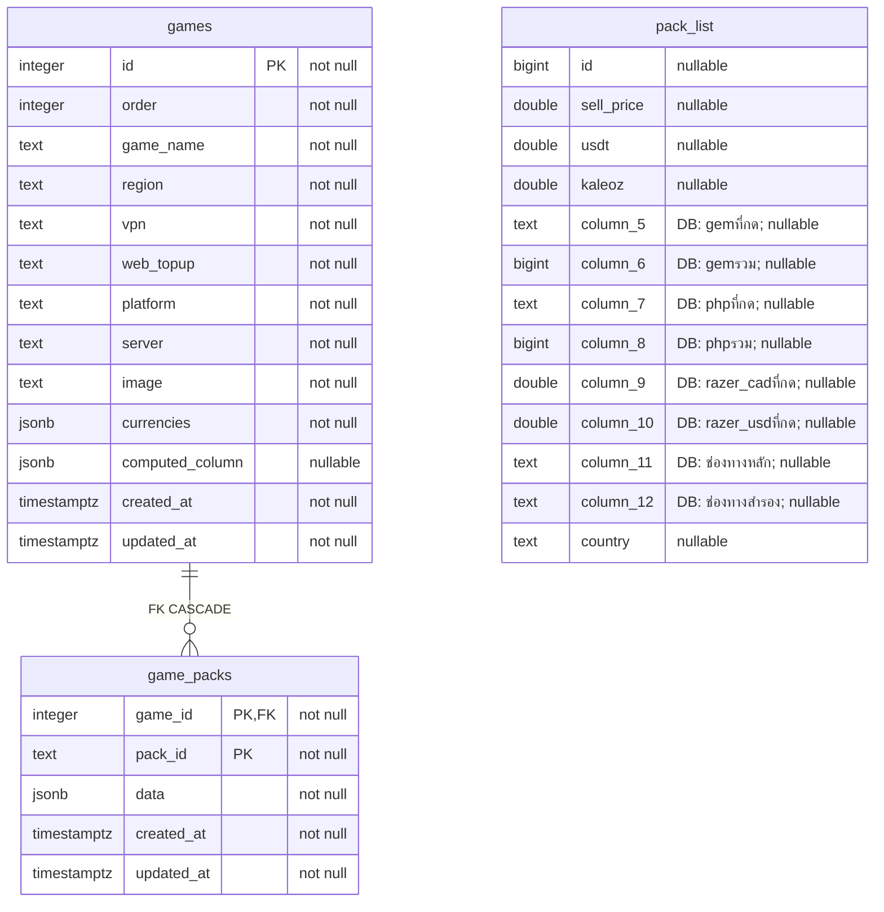

# Database ER Diagram

Schema snapshot: 2026-08-22 (Asia/Bangkok)

เอกสารนี้สร้างจาก PostgreSQL catalog ของฐานที่รันจริงแบบ read-only:

- `inblackm_system`: 15 base tables
- `topup_inblackm`: 34 base tables
- Saved connections `gameinfo` และ `topup_inblackm` ชี้ไปที่ฐาน `topup_inblackm` เดียวกัน
- รวมฐานจริง 49 ตาราง; `gamedb_cell_notes` เป็นตารางลำดับที่ 50 ที่มี DDL ในโค้ดแต่ยังไม่มีในฐานจริง

## Legend

- `PK` — Primary key จริง
- `FK` — Foreign key constraint จริง
- `UK` — Unique constraint/index จริง; หากเป็น composite key เครื่องหมายจะอยู่ทุกคอลัมน์ในชุด
- `LOGICAL` — แอปเชื่อมข้อมูลด้วย column/JSON/การ JOIN แต่ PostgreSQL ไม่มี FK constraint
- `nullable` / `not null` — nullability จาก schema จริง
- ชื่อคอลัมน์ภาษาไทยใน `pack_list` ใช้ alias ASCII เพื่อให้ Mermaid render ได้ โดยชื่อจริงอยู่ในคำอธิบายของคอลัมน์

## Database overview

PostgreSQL ไม่รองรับ FK constraint ข้ามฐานข้อมูล เส้นข้าม `inblackm_system` และ `topup_inblackm` จึงเป็น `LOGICAL` เท่านั้น

## 1. System and queries — `inblackm_system`

`gamedb_shares_live_query` เป็น partial unique index บน `query_id` เฉพาะแถวที่ `revoked_at IS NULL`

## 2. Users and permissions — `inblackm_system`

`gamedb_user_preferences.default_view_id` เชื่อมแบบ `LOGICAL` ไป `gamedb_views.id`

## 3. Game Info — `topup_inblackm`

`gamelist_favorites.user_id` เชื่อมข้ามฐานแบบ `LOGICAL` ไปยังผู้ใช้ของ `inblackm_system`

## 4. Packs and catalogs — `topup_inblackm`

ความสัมพันธ์ต่อไปนี้อยู่ข้ามกลุ่มในฐานเดียวกันและเป็น `LOGICAL`:

- `game_list.id` → `gamelist_packs.game_id`, `gamelist_pack_audit_logs.game_id`, `gamelist_pack_view_presets.game_id`, `gamelist_tags.game_id`, `gamelist_publishers.game_id`
- `gamedb_users.id` → `gamelist_pack_view_presets.user_id`, `gamelist_pack_languages.created_by`, `gamelist_pack_audit_logs.actor_id` เป็นความสัมพันธ์ข้ามฐาน
- Unique index จริงของ preset คือ `(game_id, user_id, name)`; `surface` ไม่อยู่ใน unique index ของฐานจริง

## 5. iTune queue and logs — `topup_inblackm`

คอลัมน์ `*_user_id`, `actor_user_id`, `created_by_user_id`, `claimed_by_user_id`, `reported_by_user_id`, `resolved_by_user_id` และ `updated_by_user_id` เชื่อมแบบ `LOGICAL` ไป `inblackm_system.gamedb_users.id` ส่วน `gamedb_user_preferences.itune_role_id` เชื่อมแบบ `LOGICAL` ไป `projectm_itune_roles.id`

`projectm_itune_release_settings` และ `projectm_itune_status_rules` เป็น singleton-style settings tables; `projectm_itune_admin_log` มี append-only trigger ใน schema ที่แอปติดตั้ง

## 6. Legacy tables — `topup_inblackm`

`pack_list` ไม่มี PK, UK หรือ FK ในฐานจริง

## Physical foreign keys

ฐานจริงมี FK constraints เพียง 3 เส้น:

| Database | From | To | On delete |
|---|---|---|---|
| `inblackm_system` | `gamedb_queries.connection_id` | `gamedb_connections.id` | `SET NULL` |
| `inblackm_system` | `gamedb_shares.query_id` | `gamedb_queries.id` | `CASCADE` |
| `topup_inblackm` | `game_packs.game_id` | `games.id` | `CASCADE` |

## Schema drift

- Live count คือ 49 base tables (15 + 34) ไม่ใช่ 50 ตามจำนวนตั้งต้น
- `gamedb_cell_notes` มี `CREATE TABLE IF NOT EXISTS` ใน `src/server/gamedb-cell-notes.js` แต่ยังไม่มีใน `inblackm_system`
- ตาราง legacy ที่มีในฐานจริงแต่ไม่มี runtime `CREATE TABLE` ปัจจุบัน ได้แก่ `games`, `game_packs`, `projectm_itune_roles`, `projectm_itune_secret_access_log` และ `projectm_itune_status_rules`
- `gamedb_user_preferences.itune_role_id` และ legacy columns บางส่วนใน `projectm_itune_*_log` ยังอยู่ในฐานจริง แม้ runtime DDL ปัจจุบันไม่ได้สร้างคอลัมน์เหล่านี้ตั้งแต่ต้น
- `gamelist_pack_view_presets` ในฐานจริงมี unique index `(game_id, user_id, name)` ซึ่งต่างจาก DDL ปัจจุบันที่ระบุ `(game_id, user_id, surface, name)`

เอกสารนี้ไม่รวม row data, password, encrypted secret หรือ connection host/user ใด ๆ
